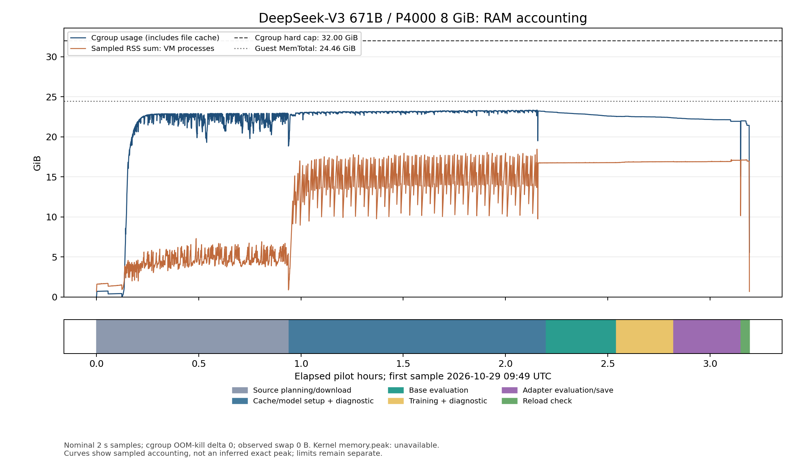

# B6 constrained giant MoE repeat, 2026-10-29

The real DeepSeek-V3 causal decoder completed preparation, two attention-LoRA
updates, the prospectively approved eight-fragment paired evaluation and exact
reload on one physical P4000 8 GiB in a recorded <=32 GiB scope. The replayed
[measurement verdict](evidence/b6-20261029/real-giant/acceptance-verdict.json)
passes with no failures. **Owner/reviewer final acceptance remains external.**
This is a two-update capacity/reload measurement, with a deliberately narrow
quality diagnostic. It establishes no broad quality, convergence or target-speed claim.

The [October 28 pilot](b6-giant-moe-20261028.md) remains a separate BF16/RTX 5060
cohort: its measured **0.1456235249 tokens/s** is unchanged and its original
`ram_32gb_hardware_validated: false` is not retroactively changed.

## Model, hardware and exact execution

- Model: `deepseek-ai/DeepSeek-V3`, revision
  `e815299b0bcbac849fa540c768ef21845365c9eb`; 671,026,419,200 decoder parameters,
  61 decoder layers, 58 MoE layers and 256 routed experts per MoE layer.
- All 163 source shards were downloaded: **688,586,727,753 bytes** in
  **2932.042663 s**. This was a fresh complete source/cache preparation.
- Compute: FP32 under the rule agreed before any new giant loss: native BF16
  when supported, otherwise FP32. Both paired arms use the same cache/dtype.
  Storage: NF4, block size 64, no double quantization.
- GPU: Quadro P4000, one visible physical device, `nvidia-smi` total 8192 MiB;
  CUDA properties expose 8,507,949,056 usable bytes. Driver 535.183.01.
- VM: six effective CPU threads, Xeon W-2133; guest MemTotal
  **26,267,844,608 bytes**, SwapTotal 0. The finite cgroup v2 hard cap is
  **34,359,738,368 bytes (32 GiB)**, with `MemorySwapMax=0`.
- Disk: 1150 provider GiB allocated; actual free bytes before source transfer
  **1,186,344,341,504**. Host advertises FIKWOT FN950 2TB NVMe; the guest sees
  a virtual ext4 block device, so host media/performance is not independently verified.
- Runtime: Python 3.12.16, torch 2.6.0+cu118 / CUDA 11.8, transformers 5.16.1,
  peft 0.20.0, bitsandbytes 0.50.2, accelerate 1.14.0; Linux 5.15.0-1067-kvm.
  [Full dependency freeze](evidence/b6-20261029/real-giant/pip-freeze.txt).
- Executed feature code: `c243b0f4f5c85a5c76ba7136231937ee9fbc185d`.
  The sealed source snapshot and its 1526-file manifest are in the adapter bundle.
  All final VM source files were checked against that manifest. An incomplete
  archive upload was never extracted; a verified changed-file archive plus the
  prior verified snapshot produced the final verified directory.

The bounded header plan derives the actual writer layout before transfer.
Its **444,017,095,552-byte** cache allowance is checked against pinned source
headers/config, the full downloaded shard set, and actual dtype/layer/suffix layout.
The generic default remains **519,579,082,752 bytes**. Source + bounded cache +
4 GiB reserve required **1,136,898,790,601 bytes**, below measured free space.
Each atomic write still checks actual codec output bytes.

Preparation produced **384,198,038,058 bytes** of cache in
**4381.027778 s** with six shard threads. Model execution uses one
Torch CPU thread. Free space after conversion was **113,464,086,528 bytes**.
The [plan](evidence/b6-20261029/real-giant/source-plan.json) and
[raw source-header archive](evidence/b6-20261029/real-giant/source-planning.tar.gz)
allow offline inspection of the disk calculation.

## Backward, updates and throughput

Rank 2, alpha 4, dropout 0, AdamW learning rate 1e-4. The same two authored
training strings and seeds as the original pilot were used; none of the eight
evaluation texts was used for training. All 305 initial LoRA B matrices were
exactly zero before the base arm. Only the five attention projections in each
of 61 layers are adapted; routed expert/base weights remain frozen.

| Update | Input tokens | Loss | Global gradient norm | Finite gradient tensors | Seconds |
| --- | --- | --- | --- | --- | --- |
| 1 | 64 | 4.194044113 | 0.547222912 | 610 | 440.079724 |
| 2 | 62 | 3.821666241 | 0.484790951 | 610 | 431.654190 |

Both updates changed the adapter hash. Combined throughput is
**126 / 871.7339143009995 = 0.1445395182325024 input tokens/s**.
Preparation, evaluation and reload are outside this training-only figure.
The low measured rate is reported without changing a target; no numerical
throughput threshold was supplied in the pasted card. No cross-hardware or
cross-precision speedup is claimed.

Peak Torch CUDA allocation through training was **7,365,200,384 bytes**;
peak reserved was **7,759,462,400 bytes**. These are allocator metrics through
the two updates, rather than a separate whole-run NVML peak measurement.
The saved adapter has **610 finite FP32 tensors / 12,125,824 parameters**.

## Prospective quality comparison

The user approved the [frozen protocol and attributed WikiText-2 data](
protocols/b6-acceptance-20261029/README.md) before any new giant loss.
Dataset revision is `b08601e04326c79dfdd32d625aee71d232d685c3`, test split.
Each sequence is unpadded and truncated to at most 64 tokens. All eight pairs
have identical token-ID digests and 63 predicted tokens each: 504 per arm.
Any finite outcome is reported, with no post-hoc quality-gain threshold.

| WikiText-2 source row | Predicted tokens | Base NLL | Adapter NLL | Adapter minus base |
| --- | --- | --- | --- | --- |
| 260 | 63 | 3.057403564 | 3.071856022 | +0.014452457 |
| 711 | 63 | 1.961974025 | 1.964350820 | +0.002376795 |
| 1275 | 63 | 1.244180679 | 1.244797111 | +0.000616431 |
| 1775 | 63 | 2.878654242 | 2.876713514 | -0.001940727 |
| 2380 | 63 | 2.596593857 | 2.588669062 | -0.007924795 |
| 2761 | 63 | 2.573756933 | 2.575625181 | +0.001868248 |
| 3373 | 63 | 2.065718889 | 2.033879519 | -0.031839371 |
| 4034 | 63 | 1.701162457 | 1.717752099 | +0.016589642 |

Token-weighted NLL: **2.259930580854 -> 2.259205415845**,
delta **-0.000725165009**. Perplexity:
**9.582423940 -> 9.575477620**.
Five individual losses increased and three decreased. This tiny aggregate
change on eight short fragments supplies **no general quality-gain or
convergence verdict**. The separate authored 54-token diagnostic was
4.580558777 -> 4.549614906; it is not substituted for the agreed primary arm.

## RAM accounting and reload

The [raw 5672 RAM samples](evidence/b6-20261029/real-giant/ram-samples.jsonl.gz)
span source planning/download, preparation, base evaluation, training, adapter
evaluation and reload. The hard cap stayed constant; process return code is 0,
cgroup OOM-kill delta is 0 and observed swap use is 0. Peak sampled cgroup usage
is **25,047,044,096 bytes**; maximum sampled sum of VM-process RSS is
**19,820,154,880 bytes**. The real model process separately reports kernel VmHWM
**20,387,213,312 bytes**; short peaks can be missed by the nominal 2 s sampler.

Kernel `memory.peak` and the global `vmstat` OOM counter are unavailable on this
kernel, recorded as null rather than invented zero peaks. The post-completion
[kernel receipt](evidence/b6-20261029/real-giant/kernel-memory-final.json)
contains no OOM messages. This establishes a constrained VM pilot, rather than
an RSS-only inference from the original larger host or a universal host/performance claim.



A fresh model/runtime loaded the saved adapter. Parameters matched the final
training digest, and the heldout logits were **bitwise equal, max absolute error 0**.
Independent CPU inspection of the actual saved tensors reconstructed native
parameter order using a tiny architecture topology, without rerunning a giant
forward or using the harness hash helper. All tensor names/shapes/finiteness
passed and its digest matches training and reload:
`c3a2d477abec09d6699b6b04d5b77b7778a19541bbf400bd9781ea08270c0b4d`.
This topology check is artifact verification, not a synthetic giant-model result.

## Reproduction and retained artifacts

The byte-for-byte [experiment](evidence/b6-20261029/real-giant/experiment.sh) and
[runner](evidence/b6-20261029/real-giant/runner.sh) record all commands. On the
fresh measured VM the enclosing command was:

```bash
systemd-run --scope --unit=b6-final -p MemoryMax=32G -p MemorySwapMax=0 \
  bash /root/b6/final-runner.sh
```

The runner launches `b6_ram.py` around the entire experiment. The experiment
plans/downloads all pinned weights, then invokes `b6_real_moe.py` with two steps,
max length 64, six shard threads, the frozen protocol/data, phase file and source
plan. Use fresh output/cache paths; the recorded run did not reuse a prior cache.

Offline verdict replay from a repository checkout:

```bash
E=benchmarks/evidence/b6-20261029/real-giant
gzip -cd "$E/ram-samples.jsonl.gz" > /tmp/b6-ram.jsonl
PYTHONPATH=.:src python benchmarks/harness/b6_acceptance_verdict.py \
  --events "$E/events.jsonl" --index "$E/cache-index.json" \
  --ram-samples /tmp/b6-ram.jsonl --physical-vram-mib 8192 --returncode 0 \
  --protocol benchmarks/protocols/b6-acceptance-20261029/protocol.json \
  --evaluation-data benchmarks/protocols/b6-acceptance-20261029/evaluation-data.json \
  --output /tmp/b6-verdict.json
```

The [adapter + executed-source bundle](evidence/b6-20261029/real-giant/b6-ram32-adapter-and-source.tar.gz)
is **49,766,614 bytes**, SHA-256
`b3abd25df64817ddcafc0b0bb4ce305a03d096573b0d17b87eada88db4478c5d`. Its [member manifest](
evidence/b6-20261029/real-giant/bundle-manifest.json) verifies each member.
The adapter safetensors file is **48,587,072 bytes**, SHA-256
`4dc426938dcf4b57d99507984090d1d3d3bd2486b6ab28db8e46047272bd873c`.

The full 72,741,435-byte raw result archive, including reference logits, is
retained locally, SHA-256
`67196621d61851e89e7c42dec95057c404990fe3ec4998281f113329e3c1f889`.
Full source weights and the generated giant cache were ephemeral and removed
with the VM. The model source remains pinned publicly; no separate independent
giant re-execution is claimed. The bundle includes the exact executed source,
protocol/data attribution, dependency freeze and adapter; its saved base path is
the VM path, so reload uses an explicitly constructed pinned base/cache as in the harness.

## Failed attempts, costs and cleanup

Earlier A-H hardware/registry/account failures remain under
[hardware receipts](evidence/b6-20261029/hardware-attempts/), with the original
first-window billing/status snapshots retained separately. They did not produce
new follow-up giant loss measurements. The user subsequently authorized up to
**$7.20 for the repeat**, including all attempts, against $3.863 prior measured spend.

| Attempt | Outcome |
| --- | --- |
| J | Offer unavailable before creation; no lease. |
| K / 58224947 | Minimal VM lacked system pip; stopped before weights, deleted; $0.023. |
| L initial | Generic disk-bound preflight correctly refused before weights. |
| L attempt2 / 3991167b | Native fused constructor requested a temporary 30,064,771,072-byte CPU reservation before Accelerate registration. Allocation refused before weights; raw tool outputs and RAM records retained. |
| L attempt3 / c243b0f4 | Complete real run reported above. No failed loss/speed trial is pooled into its measurements. |

The native constructor fix scopes only fused-expert factories to meta, restores
the constructor on exit and preserves ordinary CPU buffer values; future expert
buffers are refused. The disk-plan refinement independently binds the actual
writer layout rather than weakening atomic write checks or the generic default.
A tiny NF4 software smoke remains explicitly labeled synthetic and supplies no giant evidence.

VM L (58226087) was deleted **after** the full result archive was downloaded and
its SHA-256 verified. A fresh independent inventory found all 11 owned B6 instance
IDs absent. No persistent B6 volume was created. The explicitly authorized
personal-account temporary SSH key was revoked, with UI success/empty-list proof;
only its public fingerprint/receipt is published, not credentials or account screenshots.

The [conservative ledger](evidence/b6-20261029/billing-cumulative.json) accounts
**at most $3.932218 for this repeat** including K, actual elapsed rental plus
180 s extra cleanup, the full 735 GB ingress / 15 GB egress allowances and $0.30
reserve. This is below $7.20; cumulative conservative accounting is **$7.795218**,
below $11.063. Provider charges currently report $4.554 cumulative / $0.691 in
the repeat window; **network posting is still pending**, so that smaller number
is not presented as the final experiment cost. Other team workloads are excluded.
All paid B6 resources are absent; no more rental is needed for hosted CI.

## CI and remaining acceptance

Required Ubuntu/Python 3.12 CI on executed feature-code head `c243b0f4` passed:
**35,968 passed, 683 skipped, 12 deselected, 2 xfailed; 86.58% coverage**.
[Run 40852163066](https://github.com/SoupTeam/soup-rnd/actions/runs/40852163066).
The report/evidence head `ebc2956a` also passed with the same counts and coverage:
[run 40890645392](https://github.com/SoupTeam/soup-rnd/actions/runs/40890645392).
The 105 selected local B6/B2 tests and Ruff passed before integration. The
process-wide Windows fstat mock is isolated to the path helper; the changelog
fragment format is corrected. The wider maintainer-triggered OS/version matrix
was not run.

The subsequent merge of `main` at `38ccc787` retains the upstream isolated
Windows OS fixture and the B6 pytest-capture regression assertions. Upstream
also fixes E4's Windows `resource` import and F3 portability. All measured B6
runtime, harness and frozen protocol bytes remain unchanged: 1523 of the 1526
manifest files still match; only `tests/test_f3_rental.py`,
`tests/test_f3_setup.py` and `tests/test_issue820_windows_symlink_open_nofollow.py`
differ. The original executed source snapshot remains sealed in the bundle;
these integration changes are not a new giant-model measurement.
After integration, the Windows path/capture, B6 and E4/F3 portability selection
passed locally: **134 passed, 1 skipped**. Full repository Ruff also passed.

Report/evidence commits do not change the measured feature code. The final
merge-candidate required status is visible in [PR #45 checks](
https://github.com/SoupTeam/soup-rnd/pull/45/checks). Owner/reviewer final acceptance
remains pending; the report does not waive that review or claim convergence,
long-context fit, full-parameter training, a giant CLI run or a target-speed result.
