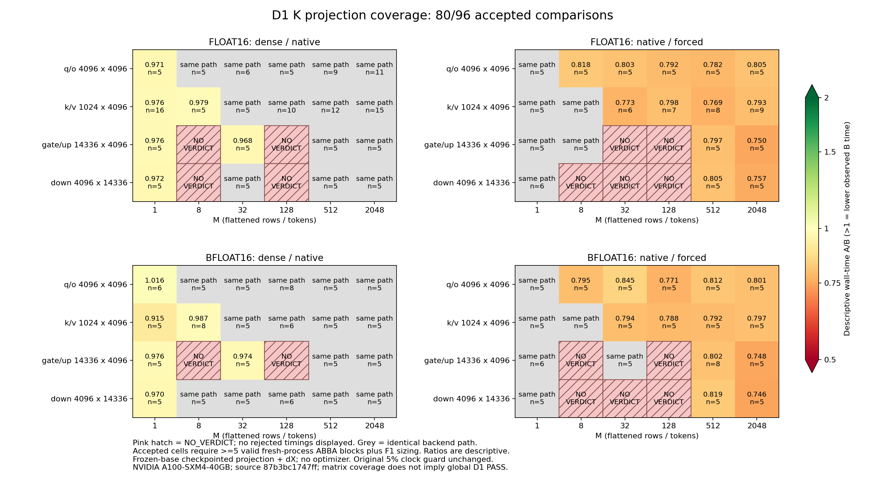

# D1 final collection: NF4 correctness and measured operating points

This is a completed research collection and review handoff, **not global D1 acceptance**. All 98 planned cells were attempted. Clock-invalid comparisons remain NO_VERDICT, with every attempt retained. Independent review is pending.

Measured source: `87b3bc1747ff78ff0fe16b8bdd2fa2eb0105d77c`. Reporting commits do not represent new CUDA executions. A100-SXM4-40GB, GPU UUID `GPU-b0245e84-f202-902b-9331-f732ab021e57`; one assigned device. The raw environment records the exact pinned CUDA stack.

## Coverage and acceptance

| Scope | Attempted cells | Accepted | NO_VERDICT |
| --- | ---: | ---: | ---: |
| float16 projections | 48 | 39 | 9 |
| bfloat16 projections | 48 | 41 | 7 |
| A100 ablation | 1 | 0 | 1 |
| A100 train | 1 | 1 | 0 |

The index accepts 81/98 comparisons, including 80/96 projections. There are 2,256 attempted arms. Accepted comparisons require at least five valid fresh-process ABBA blocks and the preregistered 10% effect-size sizing. Ratios are descriptive, not statistical significance claims. Same-path cells are labelled separately.

The provider denied clock locks. The original 5% combined clock-range guard was retained. The predeclared coverage continuation skipped completed and terminal clock-invalid cells, collecting the remaining independent cells without changing the numeric source or retrying rejected clock cases. The original report builder still returns INCOMPLETE.

## Findings

Native dispatch must be measured at the actual bitsandbytes version and shape. Forcing a Function does not ensure a fused forward. The audited FP16 q/o M=512 case takes native `dense` versus `function:dense_fallback`; the forced forward control reports custom=0/fallback=1. Its backward explicitly dequantizes dense W and uses torch.matmul for dX. Phase events and source inspection are consistent with this mechanism, but do not establish a causal cost breakdown.

The detailed report lists all accepted native-fused cells regardless of the sign of their time change, and all accepted native/forced operating points with forward/backward events and allocated/reserved deltas. Small-M allocated savings must not be treated as a full-SFT capacity gain. No average across geometries or physical GPUs is reported.

The same-session dense GEMM event reference has no separately retained telemetry window; no frequency-matched ceiling multiplier is claimed. The cached-zero ablation uses garbage mathematics and is a timing-only probe. There is no sm120, 8B/70B full-model multiplier or new fused backward result.

## Repeated QA training

CPU evidence replay passed for 20 full TinyLlama/SQuAD runs, 276 actual optimizer updates and 64 held-out predictions per arm. All 176 adapter matrices changed. Initial/final adapters, complete loss sequences, predictions and gold records were checked. Repeated identical seeds validate parity and reproducibility, not independent-seed quality generalization. The separate synthetic thermal prelude is excluded from QA updates.

Held-out 64-example quality: EM 50.000000, F1 52.781593; false-answer rate among unanswerable examples 31.0345% (9/29). The post-hoc constant NO_ANSWER control gives EM/F1 45.3125; it is not a before-training model baseline. No training-improvement claim is made.

A100 QA: 5 valid ABBA blocks; native 325.090199 ms, forced 368.820571 ms per measured step, A/B 0.881432. Peak allocated native/forced 863,867,904/863,867,904 bytes; reserved 1,042,284,544/1,042,284,544 bytes.

Non-padding throughput native/forced 781.244/685.781 tokens/s; supervised 18.951/16.635 tokens/s. This is the measured RAM-tier host workload, not an isolated GPU compute or card-ranking benchmark.

The separate RTX 3090 F cohort has five valid QA blocks: native 241.1833 ms versus forced 255.9017 ms, with equal allocator peaks and exact repeated parity. Its timing is not pooled with A100. Held-out quality differs between F and K; this study does not isolate the cause of that cross-cohort difference. Exact parity refers to repeats within each cohort.

## Review and reproducibility

[The evidence directory](evidence/d1-a100-k-20261016/README.md) contains the full index, CSV, all derived audits, plot, per-file raw manifest, credential-scan outcomes, release confirmation and CPU consumer script. Both FP16/BF16 alias-correctness replays and every projection witness were audited. CUDA regression evidence is 12 passed / 17 deselected.

The fresh local consumer restored and hash-checked all raw files, rebuilt the index, redrew the figure, and reran correctness, projection, mechanism and QA audits without CUDA contexts or model downloads. This is a separate local replay, not independent reviewer acceptance.

The raw `.tgz` and historical RTX 3090 raw archive are included in the local handoff ZIP; the large raw archive is not committed here. A reviewer needs the handoff file to reproduce numerical audits. `full-proof-manifest.json` records its exact SHA and every raw file. SQuAD attribution is preserved in DATA_NOTICE.md.

Rental 56108892 was deleted and verified absent after lossless local export. The producer's $10 cumulative budget is not authorization for reviewer cloud spending.

For full timing acceptance, collect a newly preregistered cohort on a host with usable clock controls and retain GEMM-ceiling telemetry. Preserve existing failures and keep physical-GPU cohorts separate. Independent review remains required before closing D1.
