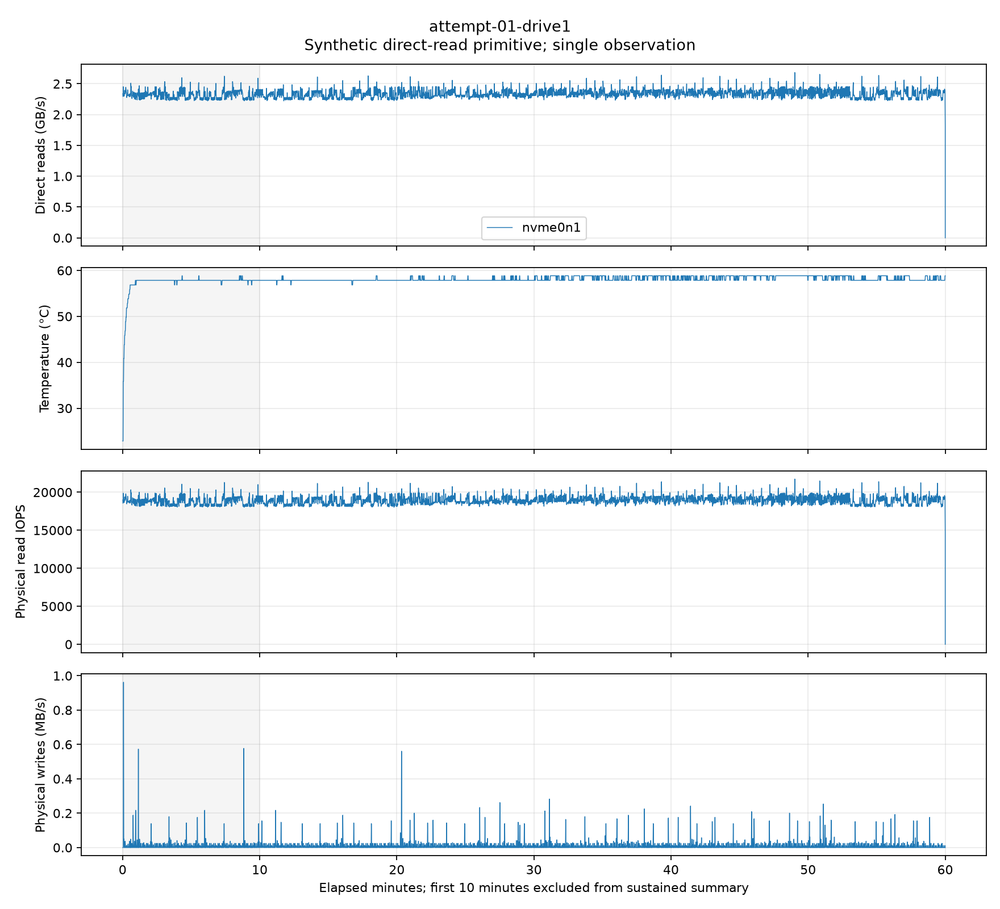
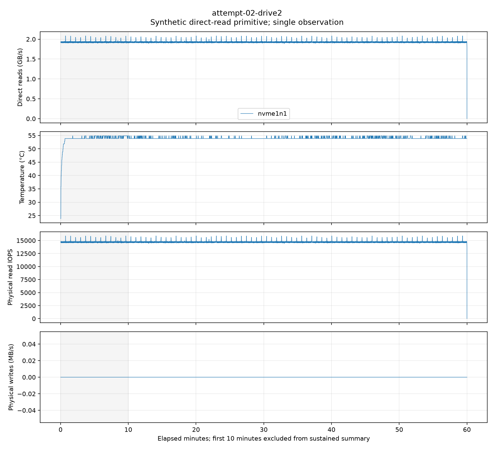
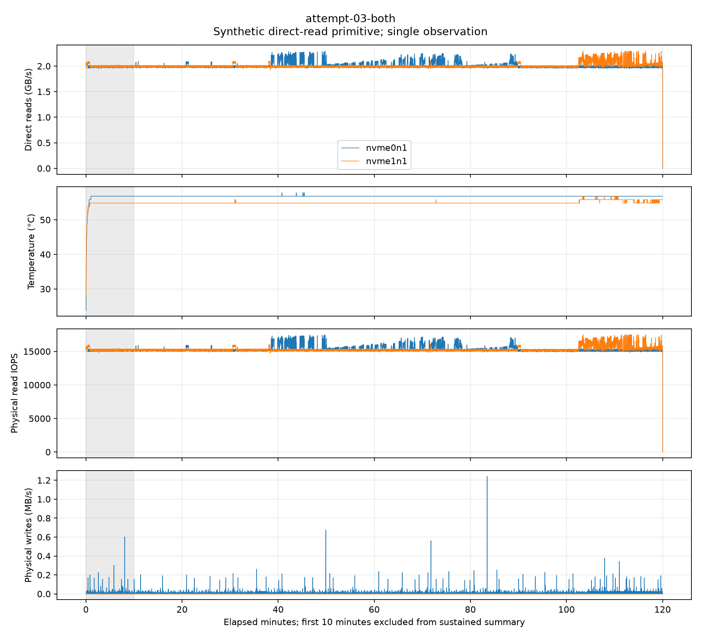

# C4: exploratory sustained reads on two Linux NVMe drives

The prospective four-hour stage is complete: two one-hour single-drive runs and one
two-hour concurrent run. All three recorded required F1 outcomes are OK, and the
archived analyzer accepts all three attempts. This is not full C4 acceptance.

## Results

GB/s uses 10^9 bytes. The first 600 seconds are recorded but excluded from sustained
estimates; summaries use complete 60-second windows. The planner value is 0.9 times
their P10, a provisional host/pattern heuristic, not a guaranteed lower bound.

| Attempt | Minutes | Post-warmup GB/s | Lowest 60-second GB/s | Planner GB/s | F1 |
|---|---:|---:|---:|---:|---|
| attempt-01-drive1 | 60.00 | 2.339681 | 2.293072 | 2.079310 | OK |
| attempt-02-drive2 | 60.00 | 1.929692 | 1.926829 | 1.735415 | OK |
| attempt-03-both | 120.00 | 4.019210 | 3.971793 | 3.582388 | OK |

The descriptive concurrent/fastest-single ratio is
**1.7178x**. Different durations and times,
one observation per condition and fixed order prevent a repeatability or causal
speed-up claim. This is concurrent independent reading, not Soup layer striping.

## Hardware and workload

- Scaleway EM-B220E-NVMe, Ubuntu 24.04, AMD EPYC 7232P; CPU-only disk workload.
- Two separately mapped Samsung MZVLQ1T0HBLB-00B00 NVMe devices, firmware FXM7401Q.
- Host RAM: 67,283,333,120 bytes. Each synthetic fixture: 85,899,345,920 bytes.
- A single run reads 80 GiB from one SSD; concurrent reading uses 40 GiB per SSD,
  preserving the 80 GiB active aggregate footprint, larger than host RAM.
- Sequential aligned 4 MiB O_DIRECT requests, QD1 per drive, no buffered fallback.
- SSD 1 also contains the OS; physical write/read accounting includes that activity.
- Device mappings, fixture hashes, source identities, timestamps and raw SMART are
  retained in the archive. Large fixture files themselves are not bundled.

## Temperature and validity

Maximum observed temperatures: SSD 1 alone 58.85 C; SSD 2 alone 54.85 C;
concurrent SSD 1 / SSD 2: 57.85 / 56.85 C. The operational stop was 70 C,
with starting temperatures at most 45 C. This is an experimental limit, not a
manufacturer continuous-use rating.

All recorded thermal-management transition/time counters, warning-temperature time,
critical-temperature time, critical-warning fields and media-error fields were zero
before and after all attempts. See `thermal-audit.json`. Counter support and firmware
coverage are not independently established; this does not prove absence of throttling.
No cooling intervention was performed. Causes of any short fluctuations remain unknown.

Required F1 checks covered suspend, power and foreign reads. Power is the no-battery
mains inference, not independent PSU telemetry. Per-device physical accounting also
passed. These thresholds do not prove zero foreign I/O or certify device-internal cache.

## Prospective protocol and attempt history

Protocol commit: `293923fbafc778b9bffde11d37fd9b6948bbf5db`. Exact protocol bytes and runner source identities
were frozen and published before the timed runs; `protocol-receipt.json` retains
the Git object linkage. The later merge into the existing C4 branch preserves that
original commit. Nine setup control cases passed before the runs. The declared
budget was three attempted timed arms and zero replacements: all three completed.
No additional timed attempts or replacements are included in this stage.

This Linux stage does not amend or repair the old laptop study's replacement-budget
deviation. That older record and all its exclusions remain separate and unchanged.

## Requirements and remaining work

| Question | This stage |
|---|---|
| Each physical SSD and concurrent reading | Measured once per condition on this host. |
| Dataset greater than RAM, cache bypass | 80 GiB active footprint and O_DIRECT; device firmware/cache remains outside the claim. |
| Sustained speed, temperature and I/O | Recorded throughout 1 h / 1 h / 2 h; figures below. |
| Planner speed | Calculated for this host and sequential 4 MiB QD1 pattern only. |
| Repeatability and order effects | Open; no repeat observations or balanced order. |
| Other read patterns and thermal attribution | Open; no pattern/cooling contrast. |
| Original multi-hour Soup SINGLE/STRIPED workload | Open; no CUDA training or original layer-streaming benchmark. |

The review approval for PR #17's older laptop report is not approval of these new
measurements. New evidence needs review; C4 must not be marked complete from this
record alone. Further experiments need a separately frozen protocol and attempt budget.

## Reproduction and validation

`raw-results.zip` contains the complete evidence, frozen runner/analyzer sources,
tests and its own manifest. Extract it to a fresh directory, then run:

```text
python tools/analyze.py --session evidence
```

Compare `evidence/analysis.json` byte-for-byte with this directory's `analysis.json`.
Reanalysis does not run a disk workload. To regenerate plots with the recorded
Matplotlib environment (see `plot-environment.txt`):

```text
python tools/plot.py --session evidence
```

Publication checks: raw ZIP SHA-256/CRC and all 93 internal manifest entries passed;
the extracted analyzer regenerated analysis.json byte-for-byte. Exact protocol bytes
match the original committed Git blob. The 43 setup CPU tests were previously run
before measurement; this publication script does not rerun or claim full repository CI.
Plot input CSVs and arm/sample files match the archive exactly. Rendering version
details are retained separately; no claim of byte-identical SVG regeneration is made.

## Figures






