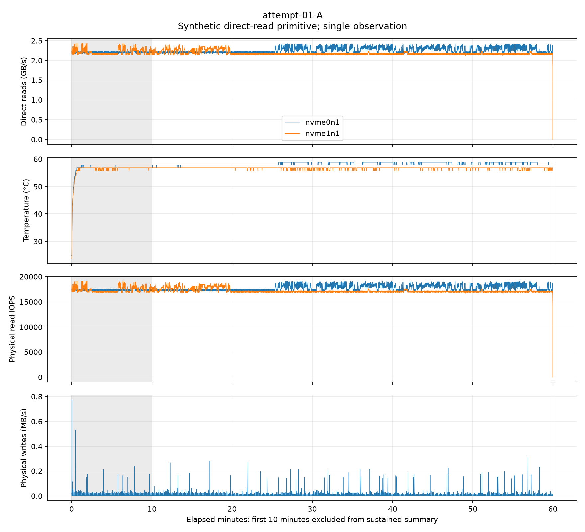
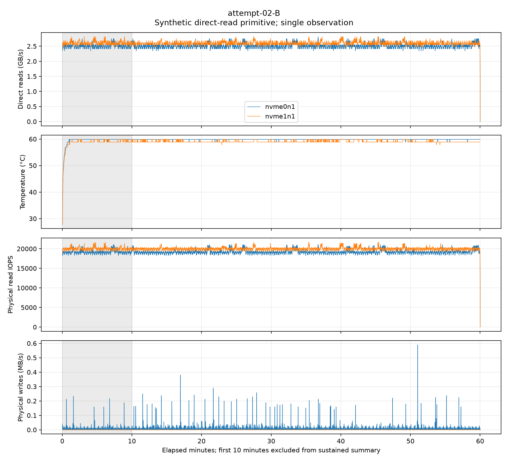
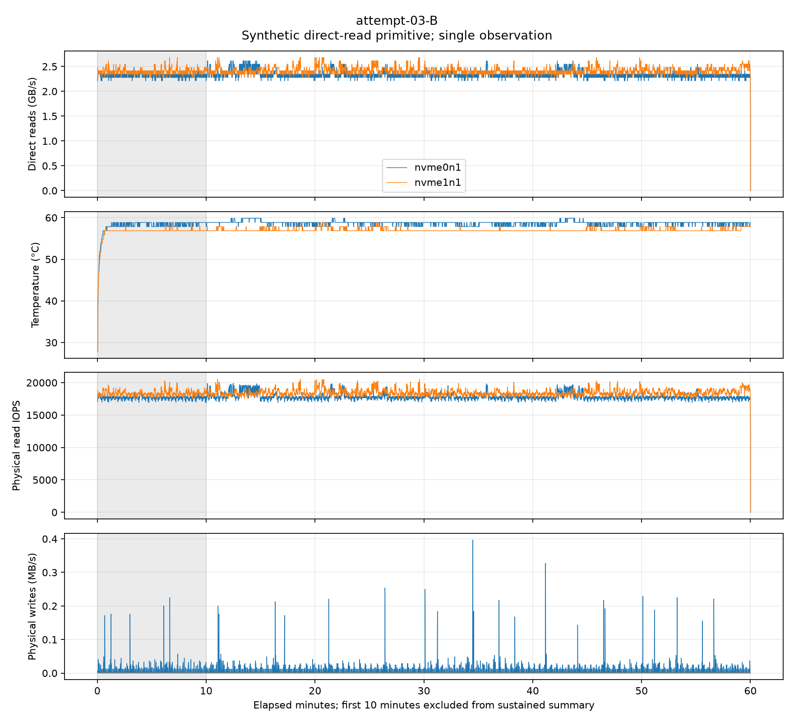
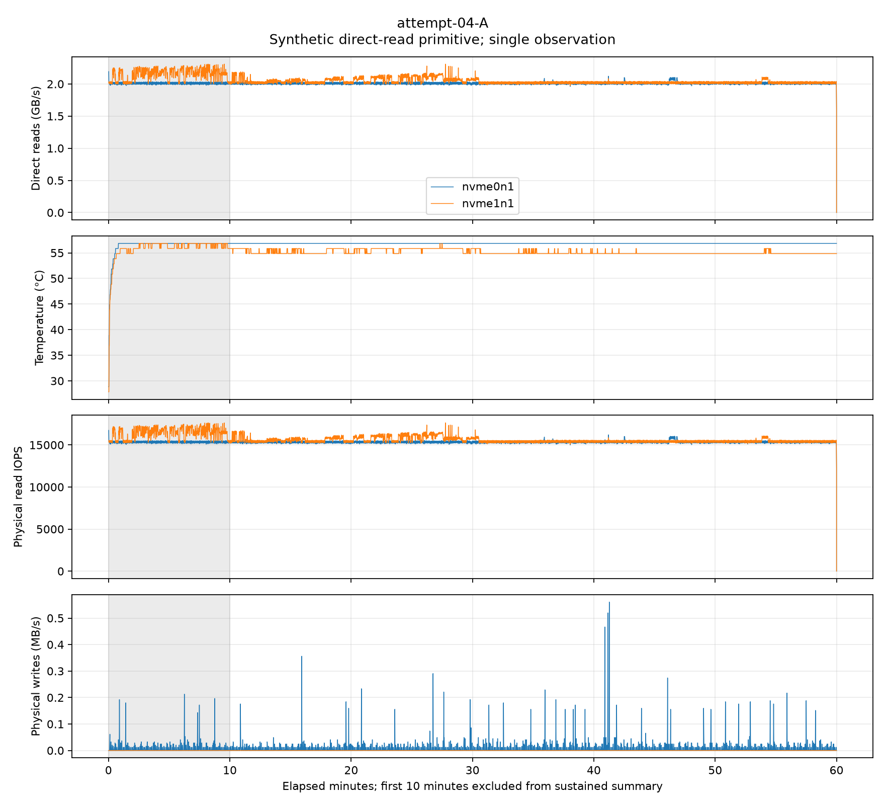

# C4: prospective concurrent NVMe request-size study

**Scope: completed exploratory ABBA series; not full C4 acceptance or Soup training.**

Timed runs: 2026-10-16T20:23:10+05:00 to 2026-10-17T00:24:13+05:00 (UTC+05:00). Directory date uses the UTC start date.

Four fresh processes read both physical SSDs concurrently: A=4 MiB, B=64 MiB,
A–B–B–A, 3600 seconds per arm, zero replacements. All four arms were accepted
by the frozen analyzer, with F1 OK and exit code 0; no timed exclusions or
replacement-budget deviation occurred in this series. Historical Windows
exclusions/deviations remain in their original report and are not repaired by this result.

## Results

Aggregate GB/s means 10^9 bytes/second. Exclude the first 600 seconds, retain
all 50 complete post-warmup 60-second windows per arm; no outlier deletion.

| Order | Request | Mean GB/s | Minimum 60s GB/s | P10 GB/s | 0.9×P10 heuristic | Max sensor °C |
|---|---|---:|---:|---:|---:|---:|
| attempt-01-A | 4 MiB | 4.445789 | 4.369954 | 4.371986 | 3.934788 | 58.85 |
| attempt-02-B | 64 MiB | 5.106466 | 5.066202 | 5.075191 | 4.567672 | 59.85 |
| attempt-03-B | 64 MiB | 4.751384 | 4.691542 | 4.709691 | 4.238722 | 59.85 |
| attempt-04-A | 4 MiB | 4.051210 | 4.021671 | 4.030146 | 3.627131 | 56.85 |

The prospective AB and BA pair comparisons give B/A=1.148607 and 1.172831,
or **+14.8607% and +17.2831%** aggregate throughput for 64 MiB.

Later/earlier repeats are A=0.911247 (**-8.8753%**) and
B=0.930464 (**-6.9536%**). Both later observations are slower.
Thus the direction of the paired request-size contrast agrees, but absolute rate
is not invariant between repeats. There are only two observations per condition;
no confidence-bound certification or universal request-size recommendation follows.

The planner column is the **predeclared per-arm 0.9×P10 heuristic**, not a guaranteed
lower bound or a new Soup default. Do not select only the fastest repeat.
Per-device metrics, both pair contrasts and all windows are in analysis.json.

## Host and measurement scope

Linux 6.8.0-146, two Samsung MZVLQ1T0HBLB-00B00 NVMe namespaces on distinct
PCIe controllers (01:00.0 and 02:00.0), with distinct hashed serial identities.
Physical RAM: 67,283,333,120 bytes. Each retained fixture is 80 GiB;
each concurrent reader cycles over 40 GiB, for 80 GiB active aggregate > host RAM.
Full fixture hashes were verified before freeze; identity checks bracket each arm.
Application-level one synchronous direct read per drive; the kernel may split a
4/64 MiB request into multiple device operations. This is not hardware queue-depth 1
certification. Both drives read independent files; this is not Soup STRIPED training.

Start-temperature ceiling 45 °C; operational stop 70 °C; temperatures sampled every 2 s,
I/O approximately every 1 s. F1 power/suspend/foreign reads and separate per-drive
read/write accounting passed; the physical read-deficit tolerance stayed 8 MiB
for both request sizes. Sub-threshold host activity is not proof of complete isolation.
Power uses the F1 no-battery inference, without independent PSU telemetry.

Maximum sampled temperature across this series: 59.85 °C. All eight published
nvme-cli counter fields in thermal-audit.json were present and 0 before/after
every arm/device snapshot. These reported zeros do not establish firmware support
for every counter or prove absence of throttling. Cooling/ambient temperature was
not manipulated; the between-repeat slowdown has no established causal attribution.

## Prospective provenance and validation

Exact protocol committed before measurements at
[bc30b69a3b71b895dd4dbaf6e655b9c4cff8280a](https://github.com/SoupTeam/soup-rnd/commit/bc30b69a3b71b895dd4dbaf6e655b9c4cff8280a).
The extracted protocol equals that Git blob byte-for-byte. The archived receipt
verifies Git object linkage and commit timestamp, not an independent trusted clock.
The earlier completed single-drive/both-drive series was already known and is
not relabelled as a prospective replicate of this new protocol.

- Archive CRC and all 87 manifest entries passed; all 12 frozen source identities match.
- Six prior instrument controls: baseline/own/foreign = OK/OK/VOID for each request size.
- All 49 bundled CPU tests passed again locally.
- The bundled analyzer regenerates analysis.json byte-for-byte and accepts 4/4 arms.
- This is evidence validation, not a fresh GPU experiment or full repository test matrix.

## Reproduce the analysis

Extract raw-results.zip into a new folder and run from that folder:

```text
python tools/analyze.py --session evidence
cd tools
python -m unittest -v test_runner test_preflight test_pattern
```

The raw ZIP includes exact runner/analyzer/test sources, all per-second samples,
controls, process logs, SMART snapshots, protocol and receipt. Large fixture files
are represented by frozen hashes/identities rather than embedded in the archive.
Plotting needs Matplotlib; plot-environment.txt records the local plotting environment.
Published SVG and local test-log whitespace is normalized before hashing; raw archive bytes are unchanged.

## Plots

Each plot shows one arm; grey marks the excluded warmup. The final near-zero
sample, where present, is the terminal sampling interval after reader shutdown,
not by itself evidence of a sustained thermal dip. No samples were deleted.









## Remaining C4 scope

This adds two observations per request size for concurrent sequential reading.
It does not repeat the single-drive-only conditions, establish cooling causality,
test random access, reproduce the original laptop dips, or execute a multi-hour
CUDA Soup SINGLE/STRIPED training comparison. Those questions and final task
acceptance remain separate. No automatic further experiment is authorized here.
