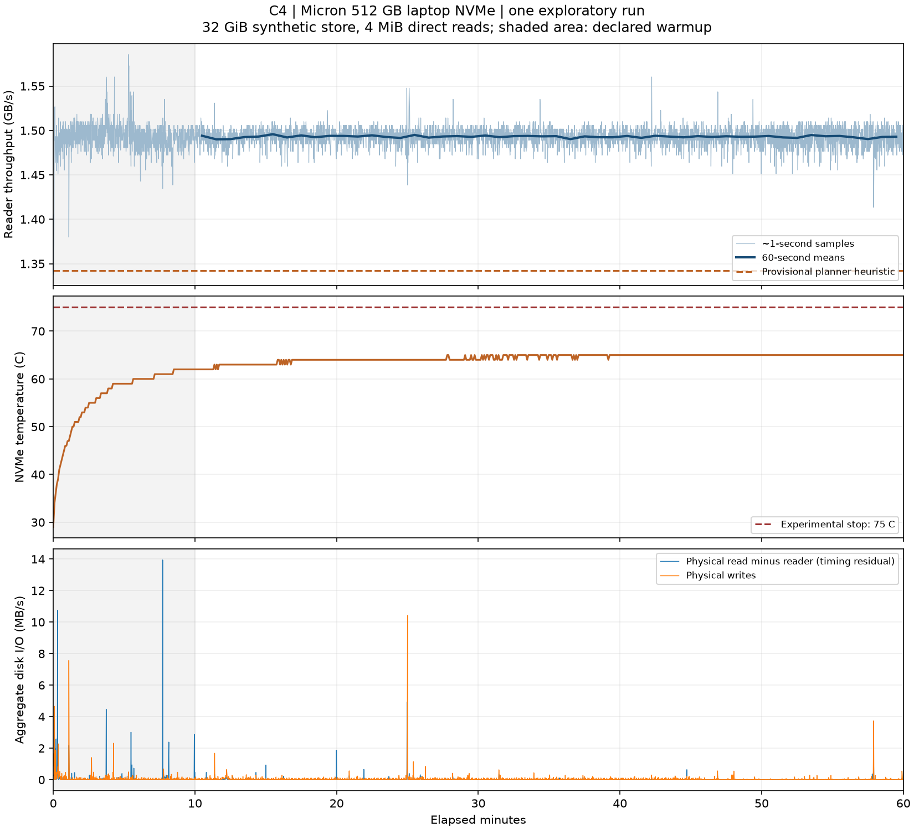

# C4: sustained direct-read rate on one laptop NVMe

This is an exploratory single-host research record, not formal C4 acceptance or a
production scheduler change. One complete candidate passes the recorded F1 checks.
Additional interrupted/incomplete attempts exceeded the declared one replacement;
all available attempts are retained. No retrospective protocol amendment conceals this.

## Result

| Metric | Observed value |
|---|---:|
| Duration | 3600 s |
| Reader bytes | 5,375,101,239,296 |
| Whole-run throughput | 1.493084 GB/s |
| First 600 s | 1.493624 GB/s |
| After 600 s | 1.492976 GB/s |
| Last 600 s | 1.492793 GB/s |
| Lowest complete post-warmup 60 s mean | 1.490047 GB/s |
| P10 of 50 post-warmup 60 s means | 1.491629 GB/s |
| Declared planner heuristic: 0.9 × P10 | **1.342466 GB/s** |
| NVMe temperature, start / maximum / end | 29 / 65 / 65 °C |
| Reader samples / thermal samples | 3600 / 713 |
| Maximum sample interval / temperature query latency | 1.016 / 0.063 s |

GB/s uses decimal bytes. The provisional planner estimate is **1.34 GB/s** for
this host, fixture and read pattern. It is a conservative heuristic rather than
a confidence bound, worst-case guarantee, or portable production default.
For a cold sequential byte-read estimate only, seconds ≈ bytes / 1.342466e9;
this excludes decoding, compute, writes and training overhead.



Minute means remain stable while temperature rises and approaches 65 °C.
The last-ten-minute mean is close to the first-ten-minute mean. These observations
do not establish absence of firmware throttling: thermal-transition counters were
not captured. Individual short dips remain unattributed; neither temperature
correlation nor aggregate disk counters identify a causal mechanism. No claim is
made about the different historical drive's periodic 11–12 second dips in the task.

## Hardware and method

- Micron MTFDKCD512QFM-1BD1AABLA, 512 GB NVMe, firmware 1002V3LN; C: on disk 0.
- Windows 11; Python 3.11.15; psutil 7.2.2; smartctl 7.5.
- Physical RAM: 16,857,817,088 bytes. Fixture: 34,359,738,368 bytes (32 GiB).
- Synthetic random bytes, sequential aligned 4 MiB reads through Soup's
  `open_direct`, Windows unbuffered I/O, EOF wrap. No GPU or training workload.
- Fixture generation SHA-256:
  `99dc1ee1a0662da894fe4dfda146310f835b3d945a2bc35c6378ff4163018aa7`.
  The 32 GiB file is not published. Preparation uses OS randomness, so regeneration
  gives a different digest and must be declared as a new fixture. Run-time checks
  used certificate, size and mtime; no full content rehash was performed at run time.
- One physical drive: separate-drive/striped comparison is not applicable.
- Planned conditions: AC, no sleep, open ventilation, start ≤40 °C, ActivityWatch
  closed, InventorySvc temporarily stopped. Service state throughout the run was
  not logged independently; the evidence is the recorded process-I/O checks.
- Reader counters sampled approximately each second; temperature approximately
  every five seconds using SMART. GPU checks explicitly not required.
- Experimental cutoff 75 °C; command timeout 5 s, freshness limit 15 s. SMART's
  reported warning/critical thresholds of 87/90 °C are not continuous-use ratings.

## Validity and protocol history

Final recorded protocol commit:
`c8e7dd35c3ed793bdd61c47ae9af3e897751136f`, committed before the selected arm.
The archived protocol bytes match the embedded protocol and runner source hashes.
Initial protocol: `a90268259d56503be13100b9ed2857370a2a02ad`.
Revision 2 (`3ac9dae09ae8f995ae94d6bfd1d410f623dea076`) raised the investigator's
65 °C cutoff to 75 °C after SMART inspection. Revision 3
(`e1ae7d05c065f89d8596e4ca9441abc15fc9e171`) replaced slow PowerShell temperature
queries with SMART. Revision 4 stopped known background readers before a replacement.

| Attempt suffix | Last recorded elapsed | Disposition |
|---|---:|---|
| 2589873dea | 225.079 s | Original 65 °C experimental stop; invalid |
| 2a67b99be3 | 30.016 s | Stale temperature query; invalid |
| 87143d8f23 | 3600 s | F1 foreign reads over threshold; invalid |
| 6f95ecf5f9 | 8 s | KeyboardInterrupt; invalid |
| b6e7a8f84d | 322.062 s | No summary/F1 completion; cause unknown, excluded |
| 7eab09a633 | 3600 s | Complete candidate; recorded required F1 checks pass |

The final candidate is the only complete passing candidate in the available
attempt set, not an average over repeats. Revision 4 declared one replacement,
but the interrupted and incomplete attempts followed before the complete candidate.
This is a protocol deviation; formal acceptance is left to review. No confidence
interval, ABBA comparison or repeatability claim is made. Failed runs are never
pooled into the scheduler calculation, and thresholds are not relaxed post hoc.

Required F1 checks: AC in all 1793 samples; maximum wall-clock sample gap ≈2.0 s;
no other process exceeded 1,000,000,000 logical read bytes, with zero uninspectable
processes. This is **not zero foreign I/O**. Windows process read counters cover
all devices and may include cached/logical reads. Physical aggregate reads exceed
reader bytes by 100,305,920 bytes; physical writes total 156,771,328 bytes.
Per-sample counter timing residuals are not attributable foreign physical reads.
Thus complete physical-I/O isolation and causality of individual dips remain unknown.

## Reproduction and evidence

Extract `raw-results.zip` into `evidence`, and `reproduction.zip` into a tools
directory. With Python 3.11+, regenerate the numeric artifact without third-party
dependencies:

```text
python tools/analyze_c4.py evidence regenerated
```

Compare `regenerated/analysis.json` byte-for-byte with the published `analysis.json`.
For graphs, install matplotlib (original rendering: 3.11.2), then:

```text
python tools/plot_c4.py evidence regenerated
```

The tools archive includes the runner, reader/F1 sources, analysis tests and run
instructions. Full command and version information are also in the raw arm records
and protocol. Live measurement requires Windows administrator access, the exact
SSD identity, SMART, AC and a newly declared protocol; reproducing the analysis
does not access a disk device. Do not blindly rerun the historical measurement.

Raw records include setup failures, smoke tests, available exclusions, all four
protocol revisions and their provenance. The large fixture and executable installer
are excluded. Historical runner snapshots were not saved separately: old source
hashes remain in each arm; only the final matching runner is bundled.

Validation: numeric interval/byte continuity, required F1 outcomes, start temperature,
thermal sample freshness, protocol/source identities and prospective commit time
checked. Three arithmetic tests and 26 runner/control tests pass. No full Soup test
suite or fresh training run was performed for this documentation change.

## Remaining work: C4 is open

The original C4 questions (agent context, source PDF page 7) extend beyond this
record. This PR preserves reproducible exploratory evidence; it is not task
completion or merge approval.

| Original question | Coverage and remaining gap |
|---|---|
| Sustained rate after warmup | One 60-minute, 4 MiB sequential run on this Micron SSD; repeatability remains unmeasured. |
| Are the sustained drops thermal? | Temperature and throughput are recorded, but there is no controlled cooling contrast or firmware thermal-transition evidence. Stable throughput up to 65 °C does not establish absence of throttling. The historical drive's periodic dips remain unexplained. |
| Does read pattern matter? | Only one pattern was measured; pattern dependence remains unanswered. |
| How does each drive behave? | This SSD only. Other physical drives, including those in the original observation, remain untested. |
| Does the two-drive benefit persist over a multi-hour epoch? | Unanswered: no second SSD, striped run or matched per-drive baselines. The historical 1.75× benefit is not validated here. |
| Which speed should a planner use? | 1.342 GB/s is a provisional host/pattern heuristic; a repeatable multi-drive planning rule remains outstanding. |

### Proposed prospective study (not authorization to run)

Before any further measurement, agree scope and resources, implement and test the
instrumentation, then commit exact source/fixture identities, settings, order,
attempt budget, exclusions and analysis. Do not amend the historical protocols.

For the available drive, a candidate design is two read patterns (sequential
4 MiB and 64 MiB, both direct I/O) crossed with two documented cooling conditions
(normal unobstructed ventilation and an available safe cooling improvement).
Use eight fresh-process one-hour attempts: A-B-D-C / C-D-B-A, where A/B are the
two patterns under normal cooling and C/D the same patterns under improved cooling.
This gives two observations per condition and reverses their order. Fix start
temperature, cooldown criteria, ambient-temperature measurement, AC/no-sleep,
background-service state, RAM pressure and all other settings before starting.
If a reproducible cooling contrast is unavailable, explicitly leave thermal
attribution open rather than treating temperature correlation as causation.

Budget: **eight attempted arms total**, including setup failures and interruptions;
no automatic replacements or extension until a desired outcome appears. Invalid
arms remain excluded and preserved; missing matched observations yield no verdict
for the affected contrast. Require the existing F1 checks, complete logs, verified
device identity, temperature freshness and operational stop, plus before/after
SMART warnings/errors and thermal-management counters where supported. Missing
thermal counters must be reported as missing, not zero.

Predeclare 600-second warmup, 60-second throughput windows, late-run versus early
post-warmup comparisons, and matched pattern/cooling contrasts within each block.
Define a dip before collecting data (proposed: at least 10 consecutive seconds
below 90% of that arm's median rate during minutes 10–20). Report duration/count,
I/O context and both replicate contrasts, including disagreement. A cooling effect
or a temperature association alone does not prove firmware throttling; use device
thermal evidence where available and keep unexplained causes unknown.

### Per-drive and multi-hour striped coverage

Needed: two independently identifiable physical NVMe drives with adequate free
space, a fixture whose active footprint exceeds effective RAM/cache, known striping
and interconnect topology, and administrator/root access to each drive's SMART,
temperature and physical I/O counters. Also needed are stable AC power, cooling,
background-I/O controls and the original read/striping implementation or a clearly
declared replacement. Access to the original drives is necessary to reproduce
their specific historical dips; a different host answers only a scoped replication.

Before this separate stage, commit the precise epoch duration (proposed: three
hours per arm), per-drive and striped layouts, equal aggregate byte workload,
validity controls and balanced order. A candidate fixed budget is nine attempts:
drive 1 / drive 2 / striped, then drive 2 / striped / drive 1, then striped / drive 1 /
drive 2, each in a fresh process; invalid attempts consume the budget. Compare
late-hour sustained rates and striped benefit against matched individual-drive
baselines, not against the historical 1.75× number alone. This is a substantial
separate study, not a request to run it now.

Two-drive coverage remains outstanding while only one SSD is available. No purchase,
rental or paid run is authorized by this plan. Formal acceptance must be resolved
separately with the reviewer. All exclusions and the revision-4 replacement-budget
deviation remain unchanged; further evidence cannot retrospectively repair them.
